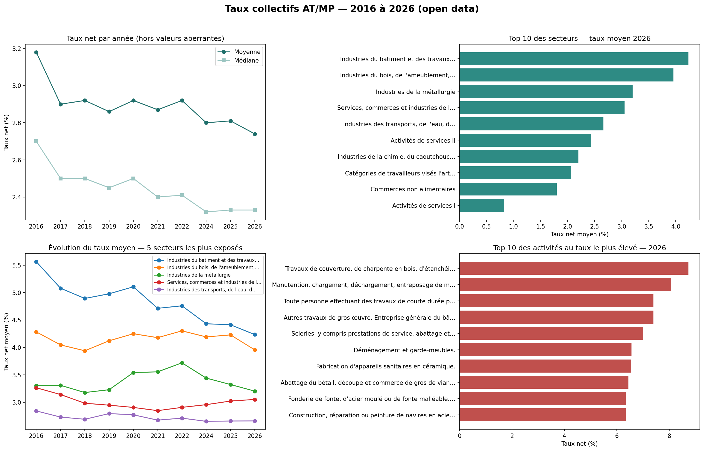
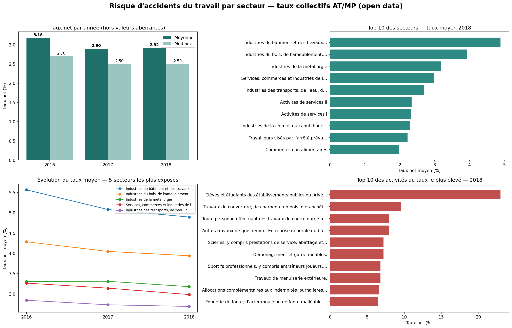

# Tableau de bord : risque d'accidents du travail par secteur (taux AT/MP, 2016-2026)

Mini-projet data réalisé en **Python (pandas, matplotlib, ipywidgets)** à partir de données publiques. Il suit la démarche d'un·e Data Analyst : charger des données hétérogènes, les nettoyer, détecter les valeurs aberrantes, calculer des indicateurs (KPI), les visualiser et en tirer des conclusions.



## Objectif

Observer comment le niveau de risque d'accident du travail évolue selon les secteurs d'activité, et savoir préparer des données pour un reporting fiable (contexte : santé au travail).

## Données

- **Source** : taux collectifs de cotisation *Accidents du travail / Maladies professionnelles* (AT/MP) par activité, publiés en open data : [betagouv/taux-collectifs-cotisation-atmp](https://github.com/betagouv/taux-collectifs-cotisation-atmp).
- **Période** : 2016 à 2026 (**10 années, sans 2023** : il n'existe pas de fichier pour cette année dans le dépôt).
- **Formats** : CSV (2016-2018) et JSON (2019-2026).
- ⚠️ Ce sont des **taux de cotisation par activité**. Ils servent d'indicateur du niveau de risque d'un secteur, mais ce **n'est pas** un nombre d'accidents.

## Méthode

1. **Chargement** de 10 fichiers, empilés dans un seul tableau avec une colonne `annee`.
2. **Nettoyage**
   - Format du taux qui change selon les années (`"6,4"` puis `"6,34 %"`) : conversion en nombre.
   - Fichier 2021 : suppression de **11 lignes d'en-têtes répétés** (« TAUX NET (en %) »).
   - Colonnes différentes selon les fichiers : on ne garde que les 4 colonnes utiles.
   - Noms de secteurs écrits différemment d'une année à l'autre (accents) : création d'une **clé de regroupement sans accents**.
3. **Valeurs aberrantes** : certaines activités ont un taux très élevé (par exemple 201 % pour « élèves et étudiants » en 2018). Elles tirent la moyenne vers le haut : les **lignes au taux supérieur à 30 % sont écartées** des moyennes (21 lignes sur 2 228). Le seuil et la liste sont documentés dans le notebook.
4. **Indicateurs (KPI)** par année : nombre d'activités, moyenne, médiane, maximum. La **médiane** est présentée à côté de la moyenne, car elle est moins sensible aux valeurs extrêmes.
5. **Visualisation** : tableau de bord de 4 graphiques, et un **filtre interactif** (choix d'un secteur et d'une année) dans le notebook `02`.

## Résultats

| | 2016 | 2026 |
|---|---|---|
| Taux net moyen | 3,18 % | 2,74 % |
| Taux net médian | 2,70 % | 2,33 % |

- Hors valeurs aberrantes, le taux net **moyen baisse d'environ 14 %** entre 2016 et 2026, et le taux **médian** d'environ 14 % également.
- Sur les **9 secteurs présents toutes les années**, **tous** affichent un taux moyen plus bas en 2026 qu'en 2016. La plus forte baisse concerne les industries du bâtiment et des travaux publics (de 5,56 % à 4,23 %), qui restent le secteur au taux moyen le plus élevé en 2026, devant les industries du bois et de l'ameublement (3,95 %).
- Les activités aux taux les plus élevés en 2026 sont des travaux de couverture et de charpente, de la manutention, des travaux de gros œuvre et des scieries.

Première version (3 années, 2016-2018) : [`01_mini_projet_atmp_3_ans.ipynb`](01_mini_projet_atmp_3_ans.ipynb).



## Limites

- Ce sont des taux de cotisation, pas des accidents. Une baisse peut aussi refléter des choix de tarification ou des changements de classement des activités : à interpréter avec prudence.
- Les moyennes ne sont **pas pondérées** par le nombre de salariés de chaque activité.
- L'année 2023 est absente des données sources.
- Le seuil de 30 % pour les valeurs aberrantes est un choix d'analyste ; d'autres seuils donneraient des moyennes un peu différentes.

## Structure du dépôt

```
├── README.md
├── 01_mini_projet_atmp_3_ans.ipynb   # première version : 2016-2018
├── 02_bonus_atmp_10_ans.ipynb        # 10 années + filtre interactif
├── data/
│   ├── atmp_nettoye_3ans.csv
│   └── atmp_nettoye_2016_2026.csv
└── images/
    ├── dashboard_atmp_3ans.png
    └── dashboard_atmp_10ans.png
```

## Lancer le projet

1. Ouvrir un notebook dans [Google Colab](https://colab.research.google.com) (*Fichier → Importer le notebook*, ou *Ouvrir depuis GitHub*).
2. Exécuter les cellules dans l'ordre. Les données sont téléchargées automatiquement depuis GitHub.
3. Le filtre interactif nécessite `ipywidgets` (déjà installé dans Colab ; en local : `pip install ipywidgets`).

## Compétences mises en œuvre

Python, pandas, matplotlib, ipywidgets · nettoyage de données (formats, accents, doublons d'en-têtes) · détection de valeurs aberrantes · KPI · visualisation · communication des limites d'une analyse.

---
**Auteure** : Imane Guihia, élève-ingénieure en Génie Digital en Santé (UM6SS) · [LinkedIn](https://www.linkedin.com/in/imane-guihia)
